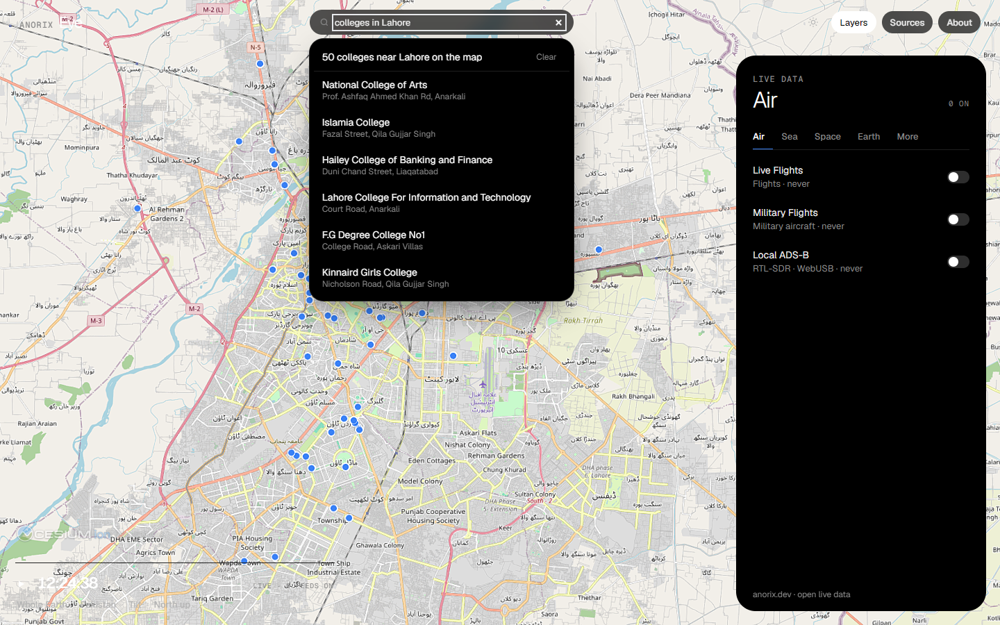

# Anorix Eye

A real-time view of the planet on a 3D globe: live aircraft, military flights, satellites, earthquakes, fires, weather, traffic, transit and public cameras from open feeds, plus place and category search ("universities in Lahore") that drops every match on the map.



> **Credit.** Anorix Eye is built on [God's Eye View](https://github.com/bilawalsidhu/gods-eye-view) by **Bilawal Sidhu**, released under the MIT License. The original license is kept in [`LICENSE`](LICENSE) and the original README in [`docs/UPSTREAM_README.md`](docs/UPSTREAM_README.md). Anorix Eye adds a new interface shell, multi-provider place search, category search and fixes; the data layers and engine are the original project's work.

## Features

- **Live layers** grouped as Air, Sea, Space, Earth and More: OpenSky flights, adsb.lol military aircraft, CelesTrak satellites, Launch Library 2 launches, USGS earthquakes, NASA FIRMS fires, NOAA weather radar, traffic, transit, bike share, public CCTV, street-level imagery and more. Toggles update live, with counts and freshness.
- **Search any place** (Nominatim + Photon + Open-Meteo, merged and ranked) and fly there.
- **Category search**: schools, colleges, universities, education, hospitals, restaurants, hotels, mosques, banks, fuel, parks and more, in a named city, the current view or near you. Results are OpenStreetMap data from Overpass, with Photon and Nominatim as fallbacks.
- **Keyless by default.** Feeds that need a key (AISStream vessels, NASA FIRMS, Cesium ion, Google 3D Tiles, voice) show as unavailable until you add one in `.env` — see `.env.example`.
- Light and dark themes, pause/play of motion, quick views (Whole Earth, Pakistan, Tilt, North up).

## Run locally

Requires Node.js 24.14+ (see `engines` in `package.json`).

```bash
npm install
cp .env.example .env     # optional: add keys for keyed feeds
npm run dev              # Vite dev server with the API middleware
```

Production build: `npm run build`, then `npm run preview` (the API middleware runs in both). `npm test` runs the unit tests.

## Data sources and credits

The full list of feeds, their licenses and terms is in [`DATA_SOURCES.md`](DATA_SOURCES.md) and [`THIRD_PARTY_NOTICES.md`](THIRD_PARTY_NOTICES.md). Highlights:

| What | Source | License / terms |
| --- | --- | --- |
| Live flights | OpenSky Network | Non-commercial research terms |
| Military flights | adsb.lol | ODbL |
| Satellites | CelesTrak | Public |
| Launches | Launch Library 2 (The Space Devs) | API terms |
| Earthquakes | USGS | Public domain |
| Fires | NASA FIRMS | NASA open data (own key) |
| Weather radar | NOAA nowCOAST | Public domain |
| Base imagery | Esri World Imagery | Esri terms of use |
| Night lights | NASA Black Marble | NASA public data |
| Map data, places, categories | © OpenStreetMap contributors (Overpass, Nominatim, Photon) | ODbL 1.0 |
| Boundaries | Natural Earth | Public domain |
| 3D globe engine | CesiumJS | Apache 2.0 |

## License

MIT, © 2026 Bilawal Sidhu (original God's Eye View). Anorix modifications © 2026 Ahsan Javed / [Anorix](https://anorix.dev). See [`LICENSE`](LICENSE).
